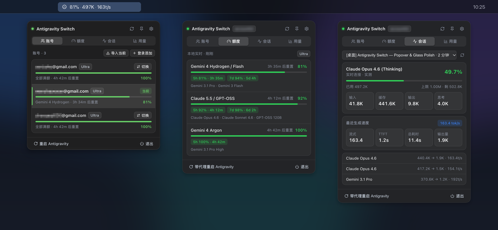
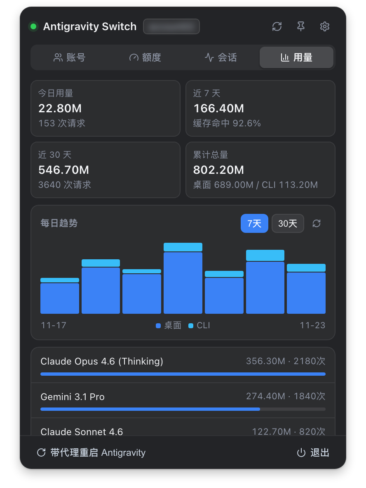
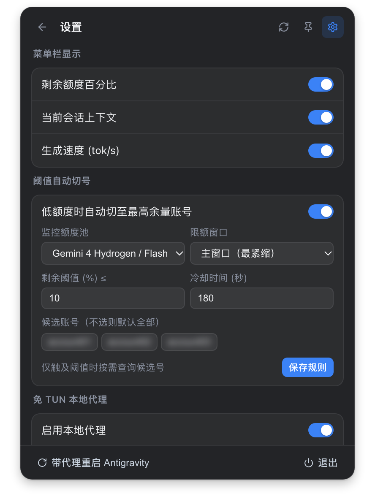

<div align="center">


# Antigravity Switch

**A lightweight, zero-reverse-proxy menubar app for Google Antigravity.**

Switch accounts cleanly, monitor quota pools & live `tok/s`, track local token usage, and launch with a local proxy — without touching `app.asar` or routing traffic through an API gateway.

<p>
  
  
  
  
  
  <a href="https://github.com/AnnaSuSu/antigravity-switch/actions/workflows/build.yml"></a>
  
</p>

<p>
  <strong>English</strong> · <a href="README_ZH.md">简体中文</a>
</p>

<p>
  <a href="#why-antigravity-switch">Why Antigravity Switch</a> ·
  <a href="#features">Features</a> ·
  <a href="#screenshots">Screenshots</a> ·
  <a href="#quick-start">Quick Start</a> ·
  <a href="#security--privacy">Security &amp; Privacy</a>
</p>

<br />



</div>

---

## Why Antigravity Switch

Google Antigravity **strictly prohibits reverse proxies and API gateway hijacking**. Many third-party switchers work by running a local reverse-proxy gateway to rewrite credentials mid-flight, or by patching `app.asar` — creating real account-ban risk and breaking on every official update.

**Antigravity Switch takes a fundamentally cleaner approach:**

| | **Antigravity Switch** | Gateway / Reverse-Proxy Switchers | `app.asar` Patchers |
| :--- | :--- | :--- | :--- |
| **Account Switching Mechanism** | **Native credential handoff** (OS Keychain / CredMan + `state.vscdb` + `~/.gemini/`) | Intercepts & rewrites API traffic via local reverse proxy | Modifies official Electron bundle |
| **Reverse-Proxy / Ban Risk** | **None** — Antigravity talks directly to official Google endpoints | High — violates anti-reverse-proxy policy | Medium — tampers with official app integrity |
| **Official Update Compatibility** | **Zero breakage** — never touches official binaries or `app.asar` | Fragile on protocol changes | Breaks on every Antigravity update |
| **Memory Footprint** | **~44 MB** physical RAM (`Tauri v2 + Rust`, OS native WebView) | Often heavy Node/Python/Electron daemon | Injected into Electron process |
| **App Size** | **~17 MB** standalone bundle | 100–300 MB+ | — |
| **Background Experience** | **Pure menubar popover** — hidden from macOS Dock, native Liquid Glass | Full window occupying Dock / taskbar | Coupled to main IDE window |

### Core Design Principles

- **Zero Reverse Proxy, Zero Patching**: Switching an account is functionally identical to signing out and signing into your other account manually — just automated into one atomic click with `GetUserStatus` verification and automatic rollback on failure.
- **Simple & Focused**: Built around the KISS principle. No bloated dashboards, no prompt injection, no unnecessary daemons — only the 5 things you actually check every day.
- **Tiny Footprint**: Native Rust backend + system WebView (`~44 MB` physical memory on macOS, `~17 MB` app bundle). Launch with `--silent` to stay dormant in the menubar without even creating a WebView until clicked.
- **Native macOS & Windows Polish**: Hidden from the macOS Dock (`Accessory` policy), native macOS Liquid Glass (`NSGlassEffectView` / `NSVisualEffectView`), content-adaptive popover height, multi-monitor & fullscreen Space support, and auto-hide on blur with an optional pin toggle.

---

## Features

- **Multi-Account Atomic Switch & Auto-Switch**
  - Import the currently signed-in account or add new accounts via standard Google OAuth2 loopback login.
  - One-click switch atomically syncs macOS Keychain / Windows Credential Manager, Desktop `state.vscdb` (surgical in-place Protobuf patching that preserves sibling sentinel keys), and `~/.gemini/` CLI credentials, restarts `language_server`, verifies the live active email, and rolls back automatically if anything fails.
  - Optional threshold auto-switch monitors a chosen quota pool (`5h` / `7d` / tightest window) and queries candidate accounts **on demand only** when your active account drops below the threshold (zero idle Google API polling).
- **Quota Pools & Live Menubar Metrics**
  - View shared model quota pools, `5h` / `7d` buckets, remaining percentages, and reset countdowns.
  - Display customizable live metrics directly in the macOS menubar: `81% · 497K · 163t/s` (toggle each item independently in Settings).
- **Live Session Context & Generation Speed**
  - Connects directly to the local Antigravity LanguageServer (`~/.gemini/antigravity/daemon/hub_*.json`) to inspect current and recent session context usage, input / cache / output / thinking token breakdown, `TTFT`, and real-time streaming `tok/s`.
- **Local Token Usage Analytics**
  - Scans local Desktop and CLI transcripts (with read-only WAL-safe SQLite model backfill) for Today / 7d / 30d / All-Time totals, cache hit ratio, daily Desktop vs. CLI stacked bar chart, and per-model breakdown.
- **No-TUN Local Proxy Launcher (Optional)**
  - Need a standard outbound network proxy (`HTTP` / `HTTPS` / `SOCKS5`) without enabling system-wide TUN mode? Validate connectivity, measure latency, and launch/restart Antigravity with standard `HTTP_PROXY` / `HTTPS_PROXY` / `NO_PROXY` and `--proxy-server` flags — strictly outbound network routing, never an API reverse proxy.

---

## Screenshots

<table>
  <tr>
    <td align="center" width="50%">
      
      <br /><sub><b>Token Usage</b> — Desktop + CLI trends, cache hit ratio &amp; per-model breakdown</sub>
    </td>
    <td align="center" width="50%">
      
      <br /><sub><b>Settings</b> — Menubar toggles, auto-switch rules, No-TUN proxy &amp; switch behavior</sub>
    </td>
  </tr>
</table>

---

## Quick Start

### Prerequisites

- **Node.js** 22+
- **Rust** (stable toolchain)
- **macOS** 13+ (Liquid Glass automatically enabled on macOS 26+) or **Windows** 10/11

### Run in Development

```bash
git clone https://github.com/AnnaSuSu/antigravity-switch.git
cd antigravity-switch
npm install
npm run tauri dev
```

### Build Standalone App

```bash
# macOS (.app bundle)
npm run tauri build -- --bundles app

# Full platform installer (macOS .dmg/.app or Windows .msi/.exe)
npm run tauri build
```

> **Tip**: Pass `--silent` (or `--background`) on startup to launch directly into the menubar/tray without popping open the panel.

### Run Rust Unit Tests

```bash
cargo test --manifest-path src-tauri/Cargo.toml
```

---

## Security & Privacy

- **100% Local-First**: Account credentials are stored locally with `0600` file permissions (`~/Library/Application Support/antigravity-switch/store.json` on macOS, `%APPDATA%\antigravity-switch\store.json` on Windows). Zero telemetry, zero third-party servers.
- **Zero Hardcoded OAuth Secrets**: OAuth client configuration is dynamically discovered from your locally installed Antigravity binary at login time.
- **Zero Idle Cloud Requests**: Background polling reads only from the local `127.0.0.1` LanguageServer daemon; remote CloudCode quota requests run only when you explicitly click refresh or when an auto-switch threshold is breached.
- **Atomic & Rollback-Safe**: Every account switch snapshots Keychain/Credential Manager, `state.vscdb`, and `~/.gemini/` first and restores them automatically if verification fails.

---

## License

[MIT](LICENSE)
