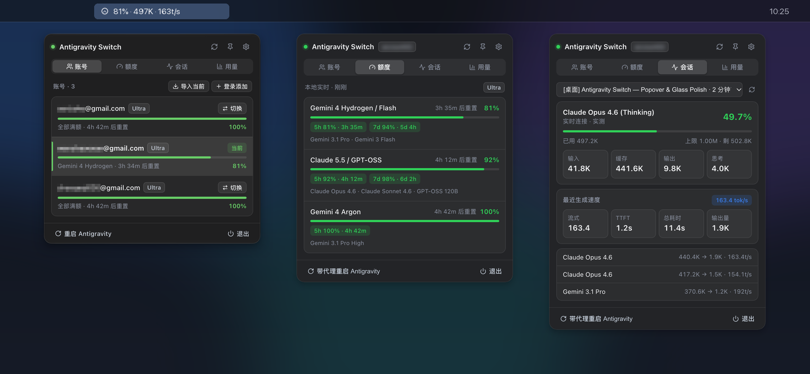
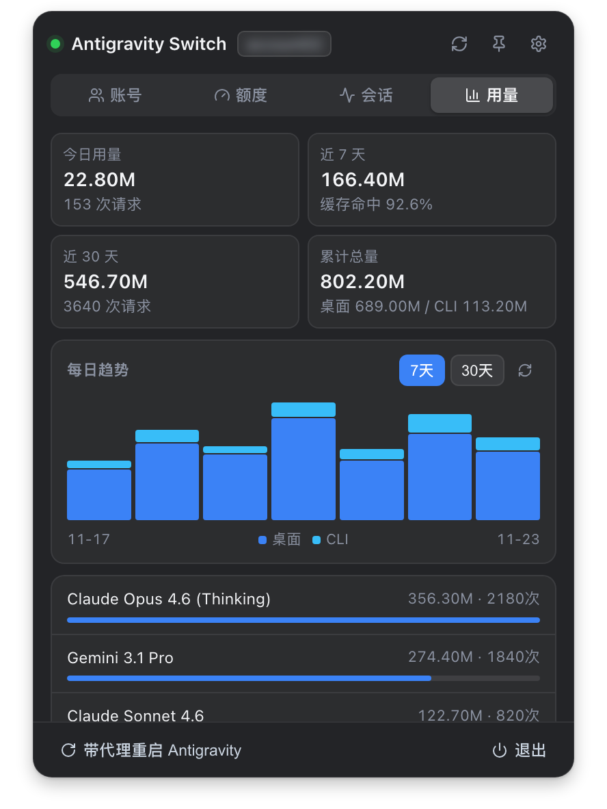
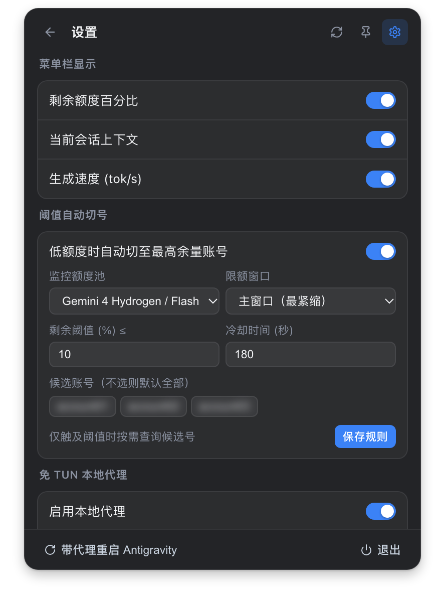

<div align="center">


# Antigravity Switch

**专为 Google Antigravity 打造的极简、轻量、零反代菜单栏助手。**

一键切号、额度池监控、实时上下文与 `tok/s` 测速、本地用量统计、免 TUN 代理启动——不改 `app.asar`，不走网关反代，常驻菜单栏几乎零存在感。

<p>
  
  
  
  
  
  <a href="https://github.com/AnnaSuSu/antigravity-switch/actions/workflows/build.yml"></a>
  
</p>

<p>
  <a href="README.md">English</a> · <strong>简体中文</strong>
</p>

<p>
  <a href="#为什么做-antigravity-switch">核心优势</a> ·
  <a href="#核心功能">核心功能</a> ·
  <a href="#更多界面预览">界面预览</a> ·
  <a href="#快速开始">快速开始</a> ·
  <a href="#安全与隐私">安全与隐私</a>
</p>

<br />



</div>

---

## 为什么做 Antigravity Switch

Google Antigravity **严禁反代与第三方网关转发**。市面上不少切号工具本质上是在本地起一个反向代理 / 网关，通过劫持并篡改 API 请求头来实现切号，或者直接魔改官方的 `app.asar`——不仅存在明显的风控 / 封号风险，官方一更新还容易失效。

**Antigravity Switch 从底层机制上就完全不同：**

| 对比项 | **Antigravity Switch** | 网关 / 反代类切号工具 | 魔改 `app.asar` 补丁 |
| :--- | :--- | :--- | :--- |
| **切号原理** | **原生本地凭据切换**（系统钥匙串/凭据库 + `state.vscdb` + `~/.gemini/`） | 起本地网关拦截并重写 API 流量（本质是反代） | 修改官方 Electron 打包文件 |
| **反代 / 封号风险** | **无反代**——Antigravity 全程直连 Google 官方接口 | 高——触碰反代红线 | 中——破坏官方包完整性 |
| **版本更新兼容性** | **零侵入**——不碰任何官方文件，随官方无痛升级 | 协议微调即失效 | 官方每次更新都要重打补丁 |
| **内存占用** | **实测仅 ~44 MB**（`Tauri v2 + Rust`，系统原生 WebView） | 常驻大内存 Node/Python/Electron 进程 | 寄生在 Electron 主进程内 |
| **软件体积** | **~17 MB** 单体原生应用 | 动辄 100–300 MB+ | — |
| **日常使用形态** | **纯后台菜单栏弹窗**——不占 macOS Dock，原生毛玻璃 | 必须开着完整主窗口占 Dock / 任务栏 | 耦合在 IDE 窗口内 |

### 核心优势

- **拒绝反代，直连官方**：切号流程只做标准本地凭据写入并重启 `language_server`，效果完全等价于你手动退出再登录另一个号，Antigravity 全程直连官方服务端，**不经过任何中间网关或 API 反代**。
- **简单克制，零多余功能**：严格遵循 KISS 原则——不做杂乱面板、不做提示词改写、不塞无用插件，只保留每天真正会用到的 5 个高频功能。
- **极低内存，体积小巧**：纯 Rust 后端 + 系统原生 WebView，macOS 实测物理内存占用仅 **~44 MB**，整个 `.app` 体积仅 **~17 MB**；支持 `--silent` 静默启动，不点开弹窗时甚至不创建 WebView。
- **原生菜单栏体验**：macOS 下不占 Dock 图标（`Accessory` 后台模式），自动适配 macOS 26+ Liquid Glass（旧版自动回退 `NSVisualEffectView`），窗口高度随内容自适应，原生支持多显示器与全屏 Space，失焦自动收起（支持图钉钉住）。

---

## 核心功能

- **多账号原子切换 & 阈值自动切号**
  - 支持「导入当前本机账号」或通过标准 Google OAuth2 回环登录添加多个账号。
  - 一键切换同步写入 macOS Keychain / Windows 原生 Credential Manager、`state.vscdb`（原地精准 Protobuf 修补，完整保留其他状态字段）及 `~/.gemini/` CLI 凭据，重启 `language_server` 后实时通过 `GetUserStatus` 校验生效；任一步骤失败自动回滚快照。
  - 可选阈值自动切号：监控指定额度池（`5h` / `7d` / 最紧缩窗口），**仅在当前号触及阈值时按需查询候选号**，平时零额外外部请求。
- **额度池看板 & 菜单栏实时常驻指标**
  - 一目了然查看共享额度池、`5h` / `7d` 窗口剩余百分比与精确重置倒计时。
  - 菜单栏直接显示实时状态：`81% · 497K · 163t/s`（剩余额度 / 上下文 / 生成速度三项均可在设置中独立开关）。
- **实时会话上下文 & 生成速度**
  - 直连本地 LanguageServer（`~/.gemini/antigravity/daemon/hub_*.json`），实时查看当前与历史会话上下文占用、输入 / 缓存 / 输出 / 思考 Token 拆解、`TTFT` 与流式生成速度（`tok/s`）。
- **本地历史 Token 用量统计**
  - 扫描本地 Desktop 与 CLI 对话记录（配合只读 WAL 安全 SQLite 模型回填），统计今日 / 近 7 天 / 近 30 天 / 累计总量、缓存命中率、每日桌面与 CLI 堆叠柱状图及分模型排行。
- **免 TUN 本地网络代理启动（可选）**
  - 不想开全局 TUN 也能让 Antigravity 走本地代理：支持 `HTTP` / `HTTPS` / `SOCKS5` 连通性测速，通过标准 `HTTP_PROXY` / `HTTPS_PROXY` / `NO_PROXY` 与 `--proxy-server` 参数启动或重启 Antigravity。*（注：此为标准客户端出站网络代理，并非 API 反代或凭据转发网关。）*

---

## 更多界面预览

<table>
  <tr>
    <td align="center" width="50%">
      
      <br /><sub><b>用量统计</b> — 桌面 + CLI 每日趋势、缓存命中率与分模型分布</sub>
    </td>
    <td align="center" width="50%">
      
      <br /><sub><b>设置页</b> — 菜单栏显示开关、自动切号规则、免 TUN 代理与切号行为</sub>
    </td>
  </tr>
</table>

---

## 快速开始

### 环境要求

- **Node.js** 22+
- **Rust**（stable 工具链）
- **macOS** 13+（macOS 26+ 自动启用 Liquid Glass）或 **Windows** 10/11

### 本地开发运行

```bash
git clone https://github.com/AnnaSuSu/antigravity-switch.git
cd antigravity-switch
npm install
npm run tauri dev
```

### 打包独立应用

```bash
# 仅打包 macOS .app
npm run tauri build -- --bundles app

# 打包完整安装包（macOS .dmg/.app 或 Windows .msi/.exe）
npm run tauri build
```

> **提示**：启动参数加上 `--silent`（或 `--background`）即可静默驻留菜单栏，启动时不主动弹出面板。

### 运行 Rust 单元测试

```bash
cargo test --manifest-path src-tauri/Cargo.toml
```

---

## 安全与隐私

- **纯本地运行**：账号凭据仅保存在本机用户目录（`0600` 权限，macOS 位于 `~/Library/Application Support/antigravity-switch/store.json`，Windows 位于 `%APPDATA%\antigravity-switch\store.json`），无任何遥测或第三方服务器上报。
- **零硬编码 OAuth 密钥**：登录时动态从本机已安装的 Antigravity 二进制中读取官方 OAuth 客户端配置。
- **空闲零外部请求**：后台定时轮询只读取本机 `127.0.0.1` LanguageServer；仅在你手动点刷新或触及自动切号阈值时才访问远程配额接口。
- **原子切换与失败回滚**：每次切号前都会完整快照系统凭据库、`state.vscdb` 与 `~/.gemini/`，校验失败自动恢复原状。

---

## 开源协议

[MIT](LICENSE)
